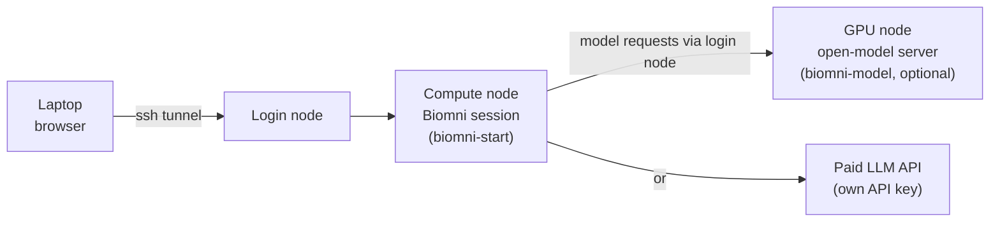

# Biomni on the cluster (Apptainer)

[Biomni](https://github.com/snap-stanford/biomni) (Stanford's biomedical AI agent) and its full "E1"
software environment, packaged as one Apptainer image for use from SLURM jobs.

```
biomni.def                     image definition
biomni.sif                     the built image
build.sbatch                   builds the image on a compute node (unprivileged, --fakeroot)
course.conf                    course settings: SLURM account, session resources, login host
bin/biomni-setup               student: one-time API key + PATH setup
bin/biomni-start / -stop       student: start/show or stop their web UI session on a compute node
bin/biomni-model               instructor: download open models, start/stop the shared model server
bin/biomni-exec                runs a command inside the image (everything else goes through this)
models/                        open-model weights, vLLM image (vllm-*.sif), catalog.tsv, server endpoint + key
docs/                          guides for instructors, students and single users
scripts/ui_app.py              the web UI with per-session password login
scripts/download_datalake.py   one-time data lake download
scripts/run_task.py            runs one agent task non-interactively
jobs/*.sbatch                  SLURM jobs: UI session, datalake download, batch task
data/biomni_data/              data lake (~11 GB) + benchmark, shared by all runs
```

## Guides

- [Instructor guide](docs/instructor-guide.md): setting up and running a course, open models, maintenance
- [Student guide](docs/student-guide.md): for beginners, from first login to results
- [Single-user guide](docs/single-user-guide.md): web UI, interactive Python and batch jobs for your own work
- [Update guide](docs/update-guide.md): moving to a newer Biomni release safely, with tests and rollback



## From a fresh clone

Images, data and model weights are too large for git (see `.gitignore`). After cloning on the
cluster, recreate them once. Run these from the clone, replacing `<account>` with your SLURM account
(also set it as `ACCOUNT` in `course.conf`):

```bash
mkdir -p logs
sbatch -A <account> build.sbatch                    # biomni.sif, ~20 min
sbatch -A <account> jobs/download_datalake.sbatch   # data/, ~11 GB, ~30 min
# Optional, for free open models:
sbatch -A <account> -p short -c 8 --mem 96G -t 3:00:00 --wrap \
  'apptainer pull models/vllm-v0.31.0.sif docker://vllm/vllm-openai:v0.31.0'
bin/biomni-model download gpt-oss-120b              # ~65 GB
```

Set `TUNNEL_HOST` in `course.conf` to a login node that compute nodes can reach with `ssh`.

## Using it in a course

The students' guide covers their side: `biomni-setup` once, then `biomni-start`,
connect the browser, and `biomni-stop`. To prepare the course:

1. **Copy the install into the course project.** Students must be able to read it. Everything
   finds its own location, so a plain copy works:
   `cp -r biomni /faststorage/project/<course>/` (about 18 GB including the data lake).
2. **Edit `course.conf`.** Set `ACCOUNT` to the course project's SLURM account. Session resources
   default to 4 CPUs, 16 GB and 4 h on `short`.
3. **Check the data lake is complete:**
   `bin/biomni-exec python scripts/download_datalake.py` should print `76/76 data lake files present`.
   If files are missing, the first student session would try to download them into a folder
   students can't write to.
4. **Add the students to the project** (`gdk-project-add-user`), then give them the guide with the
   real path to `bin/biomni-setup` filled in.

How a session works: `biomni-start` (login node) submits `jobs/ui_session.sbatch` with the
`course.conf` resources and waits for the UI to come up. It then prints the node, the port, a
random password and the tunnel command. The password is held in `~/biomni_work/.sessions`, mode
600. The UI listens on the compute node's port behind Gradio's username/password login. It is
reached with `ssh -L 7860:<node>:<port> <user>@login.genome.au.dk` or VS Code port forwarding. Biomni's
built-in access code (`Biomni2025`) is public and is not used. Each student's files go to
`~/biomni_work/session_<date>_<time>/`.

## Open models (no API key)

`bin/biomni-model` runs one vLLM server (OpenAI-compatible API) on a GPU node that every
session with `BIOMNI_COURSE_MODEL=1` in its `~/.biomni.env` uses (`biomni-setup` option 0):

```bash
bin/biomni-model list                                  # catalog + what is downloaded
bin/biomni-model download gpt-oss-120b                 # CPU job, into models/<name>
bin/biomni-model start gpt-oss-120b 8                  # 8 h on the catalog's GPU (1 x H200)
bin/biomni-model start gpt-oss-120b 2 gpu-short 2      # or 2 x L40S on gpu-short
bin/biomni-model status | stop
```

- The server job (`jobs/model_server.sbatch`) writes `models/endpoint` (URL, model) once it answers,
  and removes it when the job ends. It requires the key in `models/.server_key` (mode 640,
  readable by the project group). vLLM reads the key from the environment, never the command line.
- `biomni-exec` turns `BIOMNI_COURSE_MODEL=1` into `BIOMNI_SOURCE=Custom`,
  `BIOMNI_CUSTOM_BASE_URL`, `BIOMNI_CUSTOM_API_KEY` and `BIOMNI_LLM`. **On GenomeDK, CPU compute nodes
  cannot reach GPU nodes**, so when the URL doesn't answer directly, it opens
  `ssh -L` through `TUNNEL_HOST` (course.conf, a login node) for the job's lifetime.
- Multi-GPU (tensor parallel) inside the container needs `NCCL_P2P_DISABLE=1` and
  `--disable-custom-all-reduce`. Both are applied automatically when more than one GPU is used.
- Add models as lines in `models/catalog.tsv`. The weights are downloaded with
  `hf download --exclude 'original/*' 'metal/*'`.

## What's in the image

The software set and versions are the ones Biomni's own `biomni_env/` setup uses, installed with
micromamba into `/opt/conda/envs`:

| env | contents |
|---|---|
| `biomni_e1` (default) | Python 3.11. This is upstream's pinned `fixed_env.yml` (scanpy, scvi-tools, rdkit, torch with CUDA, gseapy, pysam, cellpose, samtools, bwa, bowtie2, bedtools, BLAST, mafft, fastqc, trimmomatic, diamond, macs2, …) plus `biomni` itself, the Gradio UI and LangChain Gemini support (Bedrock: `langchain-aws` conflicts with the pinned env and is not included) |
| `biomni_r` | R 4.4 with r-essentials, DESeq2, edgeR, limma, clusterProfiler, WGCNA, harmony, dada2, xcms, flowCore, lme4 |
| `biomni_tools` | plink, plink2, gcta64, iqtree2, FastTree, muscle, HOMER, mageck |
| `bio_env_py310` | cnvkit (Biomni calls it via `conda run -n bio_env_py310`) |
| `plannotate` | pLannotate |

The image puts `biomni_e1` first on `PATH`. The tool and R environments come after it, so their
binaries are available without overriding the agent's Python. Inside the image, `conda` is a
micromamba shim.

The image does **not** include the heavy optional model packages from `new_software_v008.sh`
(transcriptformer, popV, arc-state, nnunet, fair-esm), nor ADFR or AutoDock Vina. Install any of
these yourself if you need them (see "Adding packages").

## Quick start

**1. API key.** Create a private env file. `biomni-exec` reads it automatically.

```bash
cat > ~/.biomni.env <<'EOF'
ANTHROPIC_API_KEY=sk-ant-...
# BIOMNI_LLM=claude-sonnet-4-5
# OPENAI_API_KEY=...   GEMINI_API_KEY=...   LLM_SOURCE=...
EOF
chmod 600 ~/.biomni.env
```

API keys that are already exported in your shell are passed through as well. So is every
`BIOMNI_*` variable (`BIOMNI_LLM`, `BIOMNI_SOURCE`, `BIOMNI_TIMEOUT_SECONDS`, …).

**2. Data lake (once).** If you skip this, every new agent would try to download about 11 GB on startup.

```bash
cd <install dir>
sbatch -A <account> jobs/download_datalake.sbatch
```

**3. Run tasks.**

```bash
# Batch: results go to ./biomni_run_<jobid>/ (answer.md, log.json, files the agent made)
sbatch -A <account> <install dir>/jobs/run_task.sbatch \
    "Plan a CRISPR screen to identify genes that regulate T cell exhaustion"

# Interactive, on a compute node
srun -A <account> -p short -c 4 --mem 32G -t 2:00:00 --pty \
    <install dir>/bin/biomni-exec python
>>> from biomni.agent import A1
>>> agent = A1()          # data path and LLM come from the environment
>>> agent.go("Predict ADMET properties for CC(C)CC1=CC=C(C=C1)C(C)C(=O)O")
```

You can also run your own scripts: `biomni-exec python my_analysis.py`, or `biomni-exec bash` for a
shell inside the image. Consider adding `bin/` to your `PATH`.

**Web UI.** Run `bin/biomni-start`, the same command students use (see "Using it in a course").

## How `biomni-exec` sets up the container

- **Clean environment.** It uses `--cleanenv`, so host modules, conda and `PYTHONPATH` can't leak
  into the image. It forwards LLM keys, `BIOMNI_*`, `SLURM_*`, proxy and thread variables. When
  running under SLURM, `OMP_NUM_THREADS` and similar default to `$SLURM_CPUS_PER_TASK`.
- **Filesystems.** `/faststorage`, `/project`, `$HOME` and the working directory are visible.
  `BIOMNI_DATA_PATH` defaults to `<repo>/data`. Set it to use another copy of the data lake, and
  add extra mounts with `BIOMNI_BIND=/path1,/path2:/mnt`.
- **GPU.** `--nv` is added automatically when a GPU is allocated (`--gres=gpu:1` on the
  `gpu-l40s` or `gpu-h200` partitions). Force it with `BIOMNI_GPU=1/0`.
- **Image.** It uses `BIOMNI_SIF`, defaulting to `biomni.sif` next to `bin/`.
- **Working directory.** The agent writes its files to the current directory, so give each task
  its own directory. `run_task.py` already does this.

## Adding packages

The image is read-only. Packages the agent installs at runtime go here:

- **Python:** `pip install` (yours or the agent's) falls back to a user install in
  `~/.local/biomni-py311` (`PYTHONUSERBASE`). This is separate from your normal `~/.local`, so
  packages in either location never affect the other. Installs there persist across runs. Delete
  the directory to reset.
- **R:** `install.packages()` writes to `~/R/biomni-library` (`R_LIBS_USER`), which persists.

For permanent additions, edit `biomni.def` and rebuild.

## Rebuilding / upgrading Biomni

```bash
sbatch -A <account> build.sbatch        # the commit pinned in biomni.def
sbatch -A <account> build.sbatch main   # or any branch/tag/commit of snap-stanford/biomni
```

A build takes a few hours. It runs unprivileged (`--fakeroot`, root-mapped user namespace) on
node-local disk and writes `biomni.sif` back when it finishes. The image's smoke tests then run
(`apptainer test biomni.sif`), and the result is at the end of `logs/build-<jobid>.log`.
`apptainer inspect biomni.sif` shows the Biomni commit the image was built from.
