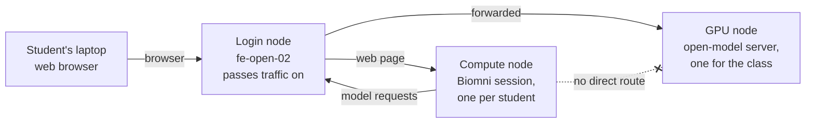

# Biomni for a Course: Instructor Guide

Oct 9, 2026 · Samuele

## At a glance

Each student runs their own Biomni web session on a GenomeDK compute node, started with one command from the login node and opened in their browser. Biomni and all its software come as one ready-made image, so students install nothing. For the AI model, students either use their own paid API key or a free open model that you run on a GPU for the whole class.

**Before the course** (about a week ahead)

- [ ] Copy the install into the course project and set `ACCOUNT` in `course.conf`.
- [ ] Check the data lake (`76/76 data lake files present`).
- [ ] Add the students to the project.
- [ ] If using the free model: download gpt-oss-120b and do a trial start.
- [ ] Run through the student guide yourself as a student.
- [ ] Send students the student guide with the real install path.

**Before each class**

- [ ] Free model: `bin/biomni-model start gpt-oss-120b <hours>` 15–30 minutes before.
- [ ] Check `bin/biomni-model status` says `Running`.

**After each class**

- [ ] Ask students to run `biomni-stop`.
- [ ] `bin/biomni-model stop` to free the GPU.

**After the course**

- [ ] Remove students, delete unused models and `models/.server_key` (see *Maintenance*).

## Folder structure

Everything lives in one folder (the *install folder*), about 70 GB with two open models. Each script finds the folder from its own location, so the whole folder can be copied or moved as a unit.

```
biomni/
├── biomni.sif              7 GB   the Biomni image: Biomni, Python, R, CLI tools
├── biomni.def                     recipe the image is built from
├── build.sbatch                   job that rebuilds biomni.sif
├── course.conf                    course settings (the only file you normally edit)
├── README.md                      technical reference
├── docs/                          these guides (instructor, student, single user)
├── bin/                           commands
│   ├── biomni-setup               student: choose model / save API key (once)
│   ├── biomni-start               student: start or show their web session
│   ├── biomni-stop                student: stop their session
│   ├── biomni-model               instructor: download / start / stop open models
│   └── biomni-exec                runs any command inside the image (used by all the above)
├── jobs/                          SLURM job scripts
│   ├── ui_session.sbatch          one student's web session (submitted by biomni-start)
│   ├── model_server.sbatch        the shared model server (submitted by biomni-model)
│   ├── run_task.sbatch            one unattended Biomni task
│   └── download_datalake.sbatch   one-time data lake download
├── scripts/                       Python run inside the image by the jobs above
├── data/biomni_data/       14 GB  Biomni's data lake and benchmark (read-only for students)
├── models/                        open models (instructor)
│   ├── catalog.tsv                models biomni-model knows, with GPU needs
│   ├── vllm-v0.31.0.sif    8 GB   model server software
│   ├── <model name>/       13–65 GB downloaded model weights
│   ├── endpoint                   address of the running server (exists only while it runs)
│   └── .server_key                access key for the server (course group only)
└── logs/                          logs of builds, downloads and model servers
```

The commands create these files in each student's own home folder:

| Path | What it is |
| --- | --- |
| `~/.biomni.env` | Their model choice and API key; readable only by them. |
| `~/biomni_work/session_<date>_<time>/` | Everything Biomni produced in one session. |
| `~/biomni_work/.sessions/` | Session logs and passwords; readable only by them. |
| `~/.local/biomni-py311/`, `~/R/biomni-library/` | Extra Python or R packages that Biomni installs while working. |
| `~/.bashrc` | One added line that puts `bin/` on their PATH. |

## Setting up the course

Do this once, about a week before the course. The working install is in `/faststorage/project/HDSSandbox/Workspaces/samuele/biomni`; below, `COURSE` is the name of the course's GenomeDK project.

1. **Get a course project.** Use an existing one, or ask for a new one with `gdk-project-request`. The project's members are the only people who can read the install, and its SLURM account pays for the students' jobs.
2. **Copy the install** into the project. This copies everything except old logs and test files; the copied files take the course project's group automatically:

   ```
   rsync -rlt --exclude logs/ --exclude .testhome --exclude STATUS.md \
       /faststorage/project/HDSSandbox/Workspaces/samuele/biomni/ /faststorage/project/COURSE/biomni/
   mkdir /faststorage/project/COURSE/biomni/logs
   ```
3. **Edit `course.conf`** in the new folder. Set `ACCOUNT` to the course project's SLURM account (the project name in lower case). The other settings are explained in its comments; the defaults suit most courses.
4. **Check the data lake** is complete:

   ```
   cd /faststorage/project/COURSE/biomni
   bin/biomni-exec python scripts/download_datalake.py
   ```

   It should end with `76/76 data lake files present`. If not, it downloads what is missing (11 GB, about 30 minutes).
5. **Add the students** to the project, one command per student:

   ```
   gdk-project-add-user -g COURSE -u STUDENT-USERNAME
   ```
6. **Test it as a student.** Run `bin/biomni-setup` yourself, then `biomni-start`, and follow the student guide end to end. This catches permission and account problems before class.
7. **Hand out the student guide** with `COURSE_PROJECT` in the setup command replaced by the real project name.

## Student sessions

When a student runs `biomni-start` on the login node, it submits a job named `biomni-ui` with the resources in `course.conf` (default 4 CPUs, 16 GB, 4 hours on `short`). On the compute node, the job starts Biomni's web interface on a free port behind a username-and-password login, with a new random password each session. `biomni-start` waits until the interface answers, then prints the node, port, password and the connection command. Each student has at most one session; running `biomni-start` again shows the running one.

**Sizing.** A session mostly waits for the AI model, so 4 CPUs and 16 GB are enough for typical tasks; raise `MEM` in `course.conf` if students analyse large single-cell files. Thirty students use 120 CPUs, a small share of the `short` partition. Sessions end automatically after `TIME`, and `biomni-stop` ends them early.

**Watching the class.** These commands, run on the login node, show who is running what:

| Command | Shows |
| --- | --- |
| `squeue -A COURSE -n biomni-ui` | All students' sessions, their state and node. |
| `squeue -A COURSE -n biomni-ui -t PENDING` | Students still waiting for a compute node. |
| `bin/biomni-model status` | Whether the free course model is running. |

You cannot cancel other users' jobs yourself; ask students to run `biomni-stop` at the end of class. Their sessions also end on their own when the time limit is reached.

## Free open models: how it works

You run one open AI model on a GPU node, and every student's Biomni uses it instead of a paid API key. Students pay nothing and need no account with an AI company; the cost is one GPU for the length of the class.

The cluster has too few GPUs to give each student one, so the model runs as a single shared server. You start it with one command; it writes its address and an access key into the course folder, readable only by members of the course project. When a student picks the free course model, their Biomni session finds the server there automatically.

On GenomeDK, the CPU compute nodes where students' sessions run cannot reach the GPU nodes directly. Each session therefore connects to the model through a login node; this happens automatically and needs nothing from you or the students.



The student's browser reaches their session through the login node, and the session's requests to the model go back through the login node to the GPU node.

## Which model to use

Use **gpt-oss-120b**. It was the only open model that solved both test tasks correctly; the smaller models either skipped running code or, when stuck on real data, invented results that looked plausible. Results from 2026-10-09, Biomni run as a student through the course setup:

| Model | GPU needed | Simple task: DNA reverse complement with code | Data task: top 5 liver genes from GTEx in the data lake |
| --- | --- | --- | --- |
| gpt-oss-120b | 1 × H200, or 2 × L40S | Correct | Correct, matching the data exactly |
| qwen3-30b | 1 × L40S | Correct | **Invented** genes and values after a coding error |
| gpt-oss-20b | 1 × L40S | **Wrong**, and ran no code | Not tested |

**Capacity.** One server is shared by the whole class. With gpt-oss-120b on 2 × L40S, 25 students sending a full Biomni request at the same moment each waited about 20 seconds for a 600-token answer (1 student: 10 seconds). Students rarely ask at exactly the same moment, so 20–30 students fit on one server. One H200 (141 GB) has about 1.5 times the memory of two L40S (92 GB), so it handles at least as many students.

**Which GPU.** The catalog default for gpt-oss-120b is one H200 (`gpu-h200`). These are often fully booked for days, so check with `sinfo -p gpu-h200` a few days before class. Two L40S GPUs give the same answers: `bin/biomni-model start gpt-oss-120b 8 gpu-l40s 2`, or on `gpu-short` (usually free, 2 hours maximum): `bin/biomni-model start gpt-oss-120b 2 gpu-short 2`.

## Once: download a model

Run these on the login node, from the course install folder. `biomni-model list` shows the available models and which ones are already downloaded:

```
cd /faststorage/project/COURSE_PROJECT/biomni
bin/biomni-model list
bin/biomni-model download gpt-oss-120b
```

The download runs as a small CPU job and is stored in `models/<name>` (13–65 GB depending on the model). It prints the job number and a `tail -f` command to follow progress; it is done when the log ends with `DOWNLOAD DONE`. The model server software (vLLM) is a separate one-time file, `models/vllm-v0.31.0.sif`, already in place.

## Before each class: start the server

Start the model 15–30 minutes before class, so students never wait for it. The second number is how many hours it runs (default 8):

```
bin/biomni-model start gpt-oss-120b 4
```

The command waits until the model answers, then prints `MODEL SERVER READY` with its address; loading takes 3–10 minutes once a GPU is free. While it waits for a GPU it prints `p`; if the GPU partition stays full, you can press Ctrl+C (the request stays queued) and check later.

| Command | What it does |
| --- | --- |
| `bin/biomni-model status` | Shows whether the server is starting or running, where, and the time left. |
| `bin/biomni-model stop` | Stops the server and frees the GPU. Run it after class. |
| `bin/biomni-model start <name> <hours> gpu-short` | Uses the `gpu-short` partition instead (often free, but at most 2 hours). |

Only one server runs at a time. To switch models, stop the server and start the other one; students then start a new session with `biomni-stop` and `biomni-start`.

## What students do

In `biomni-setup`, students type `0` for **the free course model**; they skip the API key step. Everything else in the student guide stays the same.

If the server is not running, `biomni-start` stops right away with `The free course model is not running right now. Please ask your teacher to start it.` Students can switch between the free model and their own key at any time by running `biomni-setup` again.

## Limits and troubleshooting

**Quality.** Even the recommended open model is weaker than the best paid models, and every model can make mistakes or, when stuck, report results it did not compute. Teach students to check the code in the right-hand panel and to confirm that numbers in the answer appear in the code output.

**GPU availability.** GPUs are shared with the whole cluster and may be booked for days. Start the server 15–30 minutes before class, and keep the `gpu-short` command ready as a fallback (2 hours maximum).

| Problem | Cause and fix |
| --- | --- |
| `biomni-model start` prints only `p` for a long time | No GPU is free. Press Ctrl+C and check `squeue -u $USER`; the request stays queued. Or stop it (`bin/biomni-model stop`) and use another partition. |
| `The server stopped before it was ready` | Read the lines printed under it, or `logs/model-server-<job>.log`. Out-of-memory errors mean the model needs more GPUs than requested. |
| Starting on several GPUs stalls after loading | Already handled: the commands turn off the GPU-to-GPU paths that hang inside containers on GenomeDK. If it happens anyway, use one H200. |
| Students get `The free course model is not running right now` | The server is not running or has reached its time limit. Check `bin/biomni-model status` and start it. |
| Students' answers stop mid-session | The server was stopped or restarted. Students run `biomni-stop` and `biomni-start` to reconnect. |
| `Could not connect to the course model (via fe-open-02)` | Compute nodes reach the model through the login node set as `TUNNEL_HOST` in `course.conf`. If that login node is renamed or down, set another one. |

## Maintenance

**Updating Biomni.** The image is pinned to one Biomni version so the course behaves the same every week. To update, rebuild it from the install folder; the build takes about 20 minutes and replaces `biomni.sif` only when it succeeds. Do not rebuild during class.

```
sbatch -A COURSE build.sbatch          # same pinned version
sbatch -A COURSE build.sbatch main     # latest Biomni from GitHub (or any tag/commit)
```

The end of `logs/build-<job>.log` says `SMOKE TESTS PASSED` when the new image works.

For the full procedure (building next to the image in use, testing it with the real install, swapping it in and rolling back) see the [update guide](update-guide.md).

**Adding software.** Biomni installs missing Python and R packages on its own while it works; these go to each student's home folder. To give everyone a package permanently, add it to `biomni.def` and rebuild.

**Adding an open model.** Add one line to `models/catalog.tsv` with a short name, the Hugging Face repository, GPU partition, number of GPUs, size and vLLM options, then `bin/biomni-model download <name>`.

**After the course.**

- Remove students with `gdk-project-remove-user -g COURSE -u STUDENT-USERNAME`.
- Delete unused model weights in `models/` to free 13–65 GB each.
- Delete `models/.server_key`; a new one is made the next time a model server starts, so former students lose access.

## Security and privacy

| What | How it is protected |
| --- | --- |
| Students' API keys | Stored in `~/.biomni.env`, readable only by the student; passed to Biomni through the environment, never on a command line other users could see. |
| Web sessions | A username-and-password login with a new random password for every session, stored only in the student's home folder. Biomni's built-in access code is public and is not used. |
| Free course model | Reachable only with the key in `models/.server_key`, readable only by course project members. |
| Install and data | The project folder is closed to non-members of the course project. |

Two things to tell students. First, Biomni runs the code it writes as the student, with the student's file permissions and internet access, so it can create, change or delete files in their home folder; they should keep important data backed up and read what it runs. Second, with a paid API key their prompts and any data Biomni reads into the conversation are sent to that AI company; with the free course model everything stays on GenomeDK. Patient or other sensitive data should only be used with the course model.
