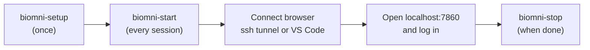

# Biomni on GenomeDK: Student Guide

Oct 9, 2026 · Samuele

## What you are about to use

Biomni is an AI assistant for biology research: you type a question in a chat window, and it plans the analysis, writes and runs the code, and shows you the results. You do not need to know how to code to use it.

Biomni does not run on your laptop. It runs on GenomeDK, the university's computing cluster, inside a ready-made software package your teacher has installed. You only need three things on your side: a terminal (or VS Code), a web browser, and access to an AI model: either the free course model your teacher runs, or your own paid API key.

The cluster has two kinds of computers. The **login node** is where you arrive when you connect; it is shared by everyone, so nothing heavy runs there. A **compute node** is a powerful machine the cluster lends you for a few hours. You give one command on the login node, and Biomni starts on a compute node for you.



## Before you start

Check these four things before the first class. Your teacher handles the first two; you handle the last two.

- [ ] **A GenomeDK account** and you can log in to `login.genome.au.dk`.
- [ ] **You are a member of the course project.** Your teacher adds you; you get an email when it is done.
- [ ] **Only if your teacher asks for it: your own API key** from Anthropic (Claude), OpenAI (GPT) or Google (Gemini). It is a long code that starts with something like `sk-ant-` or `sk-`. Using it costs a little money per question, charged to the account that owns the key. Treat it like a password: never share it or paste it into a chat or email.
- [ ] **A way to connect:** the Terminal app (Mac/Linux), PowerShell (Windows), or VS Code with the *Remote - SSH* extension.

In this guide, text in `grey boxes` is something you type exactly as shown and then press **Enter**. Where you see `YOUR-USERNAME`, type your own GenomeDK username instead.

## One-time setup (5 minutes)

You do this once. It saves your API key in a private file and teaches the cluster the Biomni commands.

1. **Log in to the cluster.** Open your terminal and type:

   ```
   ssh YOUR-USERNAME@login.genome.au.dk
   ```

   Type your password when asked (nothing appears while you type — that is normal). In VS Code instead: open the Remote Explorer, connect to `YOUR-USERNAME@login.genome.au.dk`, then open a terminal with **Terminal → New Terminal**.
2. **Run the setup command:**

   ```
   /faststorage/project/COURSE_PROJECT/biomni/bin/biomni-setup
   ```
3. **Choose the AI model.** Type `0` for the **free course model** that your teacher runs (no API key, no cost) — use this unless your teacher says otherwise. Type `1` for Anthropic, `2` for OpenAI or `3` for Google if you have your own API key. Then press Enter.
4. **Only if you chose 1, 2 or 3: paste your API key** and press Enter. Nothing is shown while you paste; that is on purpose, so nobody can read it over your shoulder. To paste in a terminal, use right-click or Ctrl+Shift+V (Cmd+V on a Mac).
5. **Activate the commands** by typing:

   ```
   source ~/.bashrc
   ```

You should see `Setup done.` If you see `That key looks too short`, run step 2 again and paste the whole key. To change your key or provider later, run `biomni-setup` again.

## Every session: start Biomni and open it

Each time you want to work with Biomni, you start your own session. It runs on a compute node for up to 4 hours, and you open it in your web browser.

1. **Log in to the cluster** as in the setup (terminal `ssh`, or VS Code).
2. **Start Biomni:**

   ```
   biomni-start
   ```

   Wait 1–3 minutes. If the cluster is busy you will see `Waiting for a free compute node...`; just wait. When it is ready, it prints a box of instructions that starts with **Biomni is running on compute node** … followed by a node name and a number, such as `cn-1040:40217`. Keep this window open; you need the details in the next steps.
3. **Connect your browser to the compute node.** Choose the way that matches how you logged in.
   - *Terminal:* open a **new** terminal window **on your own computer** (not on the cluster) and copy the `ssh -N -L 7860:…` line that `biomni-start` printed. Log in when asked. The window then shows nothing at all — that is correct; leave it open while you work.
   - *VS Code:* open the **PORTS** tab at the bottom, click **Forward a Port**, type the node and number that `biomni-start` printed (for example `cn-1040:40217`) and press Enter. Use the address in the **Forwarded Address** column in the next step.
4. **Open Biomni** in your browser at `http://localhost:7860` (or the VS Code forwarded address).
5. **Log in** with your cluster username and the **session password** that `biomni-start` printed. The password is new for every session.

Lost the instructions or closed the window? Run `biomni-start` again: it shows the details of the session that is already running instead of starting a second one.

## Using Biomni

Type your question in the box at the bottom and press Enter. The left panel (**Biomni A1 Agent**) shows Biomni's plan and answers; the right panel (**Biomni Executor**) shows the code it writes and runs. A question can take from one minute to over ten; you can watch the right panel to see it working.

Examples to try first:

- `Which genes are most often mutated in breast cancer? Give me the top 10 with a short explanation.`
- `Predict the ADMET properties of ibuprofen: CC(C)CC1=CC=C(C=C1)C(C)C(=O)O`
- `Design 5 guide RNAs to knock out the human gene TP53 and explain how you chose them.`
- `I have a single-cell RNA-seq file at /home/YOUR-USERNAME/biomni_work/pbmc.h5ad. Annotate the cell types and make a UMAP plot.`

**Working with your own files.** The safest way is to copy the file into your `biomni_work` folder on the cluster and tell Biomni its full path, as in the last example. The paperclip in the chat box also uploads a file, but that copy is temporary and disappears when the session ends.

**Where results go.** Every file Biomni creates (tables, plots, reports) is saved in a new folder for each session, named by date and time, for example `~/biomni_work/session_2026-10-14_1015`.

Good habits:

- Ask one clear task at a time, and say what you want back (a table, a plot, a short summary).
- Check the right panel: every number in the final answer should appear in the output of code Biomni actually ran. AI models, especially the free course model, sometimes report results they never computed when they get stuck.
- The chat itself is **not** saved. Copy anything important (each message has a copy button) before you stop the session.
- With your own API key, every question costs a little money and very long tasks cost more; the free course model costs nothing.

## When you are done

Stop your session so the compute node goes back to your classmates. In the terminal connected to the cluster, type:

```
biomni-stop
```

You can also close the extra tunnel window (or the forwarded port in VS Code). If you forget, the session stops by itself after 4 hours; anything not saved in your session folder is lost then.

**Copying results to your laptop.**

- *VS Code:* in the Explorer, open the folder `biomni_work`, right-click a file or folder and choose **Download…**.
- *Terminal:* on your own computer (not the cluster), run the command below. It copies all your Biomni results into a folder `biomni_work` in your current folder:

  ```
  scp -r YOUR-USERNAME@login.genome.au.dk:biomni_work .
  ```

## If something goes wrong

Most problems are fixed by one of the steps below. If none helps, send your teacher the exact message you see (a screenshot is fine).

| What you see | What to do |
| --- | --- |
| `biomni-start: command not found` | Type `source ~/.bashrc`, or log out and in again. If it still fails, run the setup command from step 2 of the setup again. |
| `You have not saved an API key yet` | Run `biomni-setup` and choose a model. |
| `The free course model is not running right now` | Your teacher starts it before class. Wait a few minutes and run `biomni-start` again. |
| `Waiting for a free compute node...` for a long time | The cluster is busy. Keep waiting, or press Ctrl+C and try again later; your request stays in the queue until you run `biomni-stop`. |
| `The session stopped before it was ready` | Run `biomni-start` again. If it happens twice, send your teacher the lines printed under the message. |
| The browser says *This site can't be reached* | The connection window from step 3 is closed or was typed wrong. Run `biomni-start` again to see the command, and paste it into a new terminal on your own computer. |
| `bind ... Address already in use` in the connection window | An old connection window is still open. Close all other terminal windows that ran `ssh -N -L`, then try again. |
| The login page does not accept your password | Use your cluster username and the password from the **latest** `biomni-start`; it changes every session. |
| Biomni answers with an error about the API key or credits | Your key is wrong, expired or out of credit. Run `biomni-setup` again with a working key, or choose the free course model. |
| Biomni stops responding after a few hours | Sessions end after 4 hours. Run `biomni-stop`, then `biomni-start`. |
