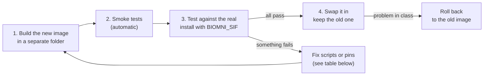

# Updating Biomni: Maintainer Guide

Updating means rebuilding the image from a newer Biomni release, testing it next to the image in use,
and then swapping it in. The image in use is never touched until the new one has passed every check,
so a failed update costs nothing. Plan about an hour, and never do it during class.



In the commands below, `$BIOMNI` is the install folder in use (for a course,
`/faststorage/project/COURSE/biomni`) and `<account>` is your SLURM account.

## Which version is installed now

```bash
apptainer inspect $BIOMNI/biomni.sif | grep git_ref       # Biomni commit the image was built from
$BIOMNI/bin/biomni-exec python -c "import biomni.version as v; print(v.__version__)"
```

Biomni's releases and changes are listed at <https://github.com/snap-stanford/biomni/releases>.
Read them first: a new release can add data lake files, change the web interface or rename settings.

## 1. Build the new image in a separate folder

`build.sbatch` writes `biomni.sif` into the folder it is run from, so build in a fresh clone of this
repository, not in `$BIOMNI`:

```bash
git clone <this repository> ~/biomni-update
cd ~/biomni-update && mkdir -p logs
sbatch -A <account> build.sbatch main        # newest Biomni; or a release tag / commit instead of main
```

The build runs on a compute node and takes about 20 minutes. The argument is any Biomni branch,
tag or commit; with no argument, the build uses the commit pinned in `biomni.def` (`BIOMNI_REF`).

## 2. Check the smoke tests

The end of `~/biomni-update/logs/build-<job>.log` must say `SMOKE TESTS PASSED`. These tests import
Biomni and its Python stack, find every command-line tool, load the R packages and run cnvkit. If they
fail, the log says which item is missing; see *When something breaks* below.

The smoke tests do **not** test the parts this repository adds around Biomni (data lake, web interface
with password login, free course model, batch tasks). Step 3 does.

## 3. Test the new image against the real install

`BIOMNI_SIF` tells every command which image to use. Exported in your shell, it also reaches the
jobs that `biomni-start` and `sbatch` submit, so you can test the new image with the real data,
settings and models while students keep using the old one.

```bash
export BIOMNI_SIF=~/biomni-update/biomni.sif
cd $BIOMNI
```

Run each check and compare with the expected result:

| # | Check | Command | Expected |
| --- | --- | --- | --- |
| 1 | Data lake complete for the new version | `bin/biomni-exec python scripts/download_datalake.py` | Ends with `N/N data lake files present` (N may grow; missing files are downloaded now, into the shared folder) |
| 2 | Web interface and login | `bin/biomni-start`, open it as in the student guide, log in | Login page appears; wrong password rejected; your password accepted; chat answers a question |
| 3 | Simple task with code | In the web interface: `Compute the reverse complement and the GC content of the DNA sequence ATGCGTACGTTAGC using Python code` | `GCTAACGTACGCAT`, `50%`, and code visible in the right panel |
| 4 | Data lake task | `Using the GTEx tissue expression data in the data lake, which 5 genes have the highest expression (TPM) in liver?` | MT-ND4 (about 58,775 TPM), MT-ATP6, MT-CO2, MT-CO3, MT-CO1 |
| 5 | Free course model | Start the model (`bin/biomni-model start gpt-oss-120b 2 gpu-short 2`), set option 0 with `biomni-setup`, repeat checks 3 and 4 | Same answers as above |
| 6 | Batch task | `sbatch -A <account> jobs/run_task.sbatch "Compute the GC content of ATGCGTACGTTAGC"` | `biomni_run_<job>/answer.md` says 50% |

Afterwards: `biomni-stop`, `bin/biomni-model stop`, `unset BIOMNI_SIF`, and run `biomni-setup` again
if you changed your model choice for check 5.

## 4. Swap it in

Outside class time, keep the old image for a quick rollback and move the new one in:

```bash
cd $BIOMNI
mv biomni.sif biomni-previous.sif
cp ~/biomni-update/biomni.sif biomni.sif
```

Sessions that were already running keep the old image until they end; new sessions use the new one.
To make the new version the default for future builds, set `BIOMNI_REF` in `biomni.def` to the commit
shown by `apptainer inspect biomni.sif | grep git_ref`, and commit that change.

**Rolling back** is the same move in reverse:

```bash
cd $BIOMNI && mv biomni-previous.sif biomni.sif
```

Once the new version has run a class without problems, delete `biomni-previous.sif` (7 GB) and
`~/biomni-update`.

## When something breaks

Most of this repository only starts Biomni, so most updates need no changes. These are the places that
depend on Biomni internals, and what to look at if a check fails:

| Failing check | Likely cause in the new Biomni | Where to fix |
| --- | --- | --- |
| Build fails while creating `biomni_e1` | New package pins in Biomni's `biomni_env/fixed_env.yml` conflict | `biomni.def`: the environment steps; try the previous release tag first |
| Smoke test `R ok` fails | Bioconductor or library versions changed | `biomni.def`: the `biomni_r` step (R version, `tbb<2021` pin) |
| Check 1 fails or sessions start downloading files | Data lake file list changed, or `data_lake_dict` / `check_and_download_s3_files` renamed | Rerun the download; `scripts/download_datalake.py` |
| Check 2: no login page, or old access-code page | `launch_gradio_demo` or Biomni's Gradio version changed | `scripts/ui_app.py` (it wraps Gradio's `launch()` to add the password) |
| Check 5 fails, checks 3–4 pass | Settings renamed (`BIOMNI_SOURCE`, `BIOMNI_CUSTOM_BASE_URL`, `BIOMNI_CUSTOM_API_KEY`, `BIOMNI_LLM`) | `bin/biomni-exec`, course-model block |
| Check 6 fails | `A1.go()` returns something other than `(log, answer)` | `scripts/run_task.py` |
| Answers are worse than before | New prompts suit the open model less well | Try a newer open model: add it to `models/catalog.tsv` and rerun checks 3–5 |

## Updating the other parts

| Part | When | How |
| --- | --- | --- |
| Data lake | When check 1 downloads new files, or Biomni announces new datasets | `bin/biomni-exec python scripts/download_datalake.py` (only missing files are fetched) |
| vLLM (model server software) | When a new open model needs a newer vLLM | Pull a new image next to the old one: `apptainer pull models/vllm-<version>.sif docker://vllm/vllm-openai:<version>` in a job with about 96 GB memory; the newest-named `models/vllm-*.sif` is used. Then repeat check 5 |
| Open models | When a better open model appears | Add a line to `models/catalog.tsv`, `bin/biomni-model download <name>`, then repeat checks 3–5 with it before recommending it |
| This repository's scripts | When you fix something | Commit the change; scripts take effect immediately, no rebuild needed |
